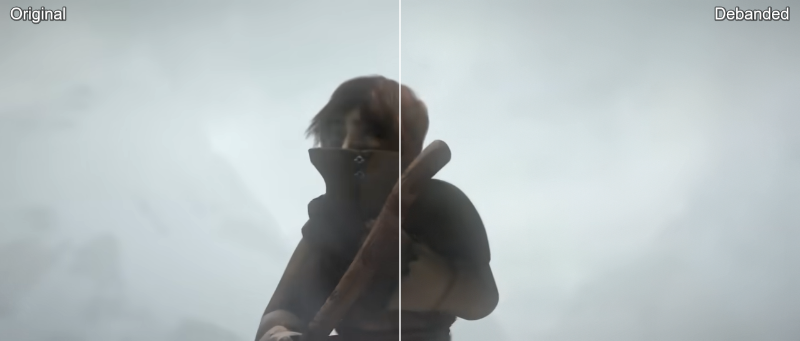
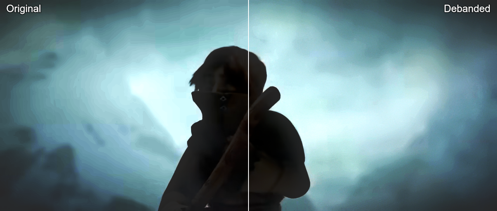
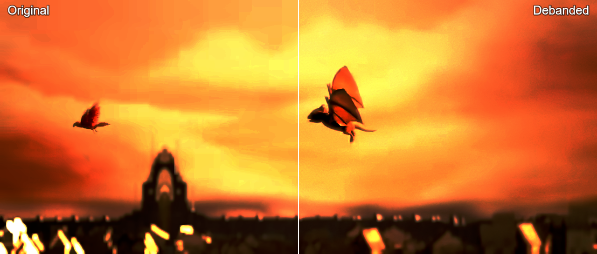
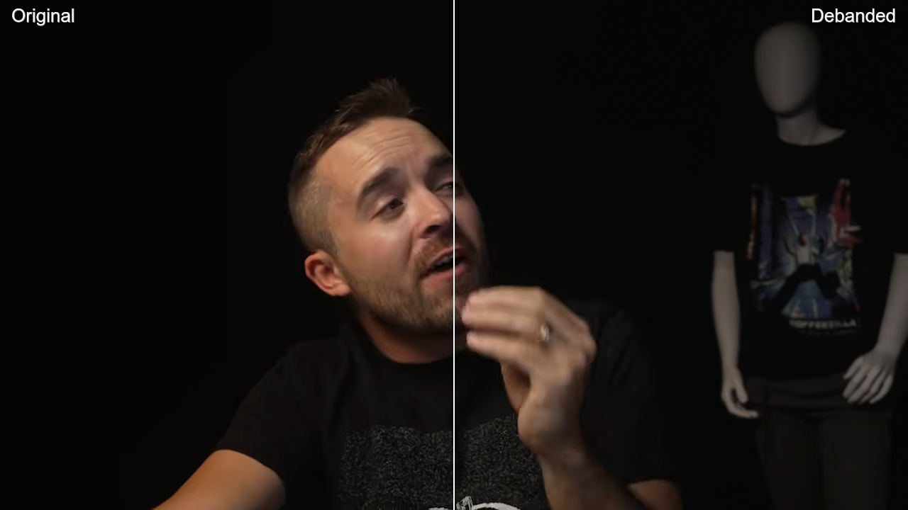
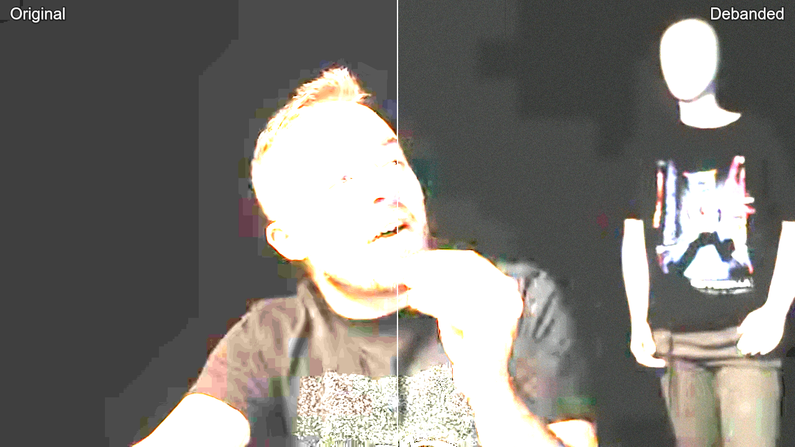

# YouTube Deband

A userscript that debands YouTube video in the browser using WebGL ports of
[mpv](https://mpv.io/)'s deband shaders, with mpv's own parameters.

- **gpu-next**: [libplacebo](https://code.videolan.org/videolan/libplacebo)
  `pl_shader_deband()`
  ([`src/shaders/sampling.c`](https://code.videolan.org/videolan/libplacebo/-/blob/master/src/shaders/sampling.c)),
  with mpv's option mapping from
  [`video/out/vo_gpu_next.c`](https://github.com/mpv-player/mpv/blob/master/video/out/vo_gpu_next.c)
- **gpu**: mpv's legacy `pass_sample_deband()`
  ([`video/out/gpu/video_shaders.c`](https://github.com/mpv-player/mpv/blob/master/video/out/gpu/video_shaders.c))
- **Fast**: gpu-next cut down to a single pass for weak GPUs (see
  [Weak hardware](#weak-hardware))

Like mpv, it debands the Y and subsampled CbCr planes separately before color
conversion: the script undoes the browser's YCbCr→RGB conversion, rebuilds the
planes, debands each one, converts back and draws on a canvas laid over the
`<video>`. Runs on WebGL2, with a WebGL1 fallback (e.g. Tor/Mullvad Browser).

## Comparison

YouTube's 720p stream of Sintel at 0:35, default settings. Left half is the
video as the browser shows it, right half is debanded:

Banding is easiest to see with the contrast boosted (both halves get the same
curve):

Sintel © Blender Foundation, [CC BY 3.0](https://creativecommons.org/licenses/by/3.0/), [durian.blender.org](https://durian.blender.org)

Near-black backgrounds band too. A talking-head video at 720p, 0:10:

With the darkest 8% stretched to full range, the original's background turns
out to be a few flat blocks of brightness:

Frame from [the largest hack. ever.](https://www.youtube.com/watch?v=_HaySrzDyWU) by voidzilla

## Install

1. Install a userscript manager such as [Violentmonkey](https://violentmonkey.github.io/)
   or [Tampermonkey](https://www.tampermonkey.net/).
2. Open the [raw script](https://raw.githubusercontent.com/Pagal3/youtube-deband/main/youtube-deband.user.js)
   and confirm the install. Your userscript manager will pick up updates from
   the same URL.

## Usage

- **Ctrl+Alt+D** toggles debanding
- **Ctrl+Alt+B** or the **DB** button in the player's control bar opens the
  settings panel

Both hotkeys can be re-recorded in the panel.

| Setting    | Default    | mpv option            |
|------------|------------|-----------------------|
| Mode       | `gpu-next` | `--vo`                |
| Iterations | 1          | `--deband-iterations` |
| Threshold  | 48         | `--deband-threshold`  |
| Range      | 16         | `--deband-range`      |
| Grain      | 32         | `--deband-grain`      |

The panel also has the YCbCr matrix (709/601), luma snapping, output dithering,
upload precision, WebGL backend and a split-screen comparison view.

### Presets

Pick a preset under **Preset** in the panel to set the four deband values at
once. The mode and the other settings stay as they are.

| Preset      | Iterations | Threshold | Range | Grain | For                                              |
|-------------|------------|-----------|-------|-------|--------------------------------------------------|
| Default     | 1          | 48        | 16    | 32    | mpv's defaults                                   |
| Subtle      | 1          | 32        | 16    | 16    | High bitrate 1080p and up                        |
| Animation   | 4          | 35        | 16    | 4     | Anime and cartoons, where grain shows on flat colors |
| Strong      | 4          | 64        | 20    | 32    | Broad bands in skies, fog and gradients          |
| Aggressive  | 4          | 100       | 8     | 32    | Hard, close-set steps like blocky dark scenes    |
| Low bitrate | 4          | 128       | 16    | 48    | 480p and below, heavily compressed uploads       |

To make your own, set the values (or paste them with **Apply mpv options**),
type a name under them and click **Save**. Saving under a name you already
used updates that preset, and **Delete** next to the list removes the selected
one. When the values match no preset, the list shows **Custom**. **Reset**
doesn't remove your presets.

## Weak hardware

If video stutters with debanding on, click **Fast** under **Mode** at the top
of the settings panel. It runs the gpu-next algorithm with the same
parameters, but in one pass straight from the video frame instead of four:

- no intermediate textures and no float textures or WebGL extensions
- always uploads the frame as 8-bit RGBA, the cheapest upload
- a cheap float hash instead of the pcg3d generator, which is slow on
  WebGL1, where it is emulated without integers
- shaders are only compiled for the mode in use

To keep it cheap, it debands chroma at full resolution with the same samples as
luma (gpu-next works on half-resolution chroma) and doesn't snap luma, so the
result is close to gpu-next but not identical.

On a GeForce RTX 3060 at 1080p, the debanding itself (without the frame upload
that every mode shares) takes about a third of the GPU time of gpu-next on
WebGL2, and a twentieth on WebGL1.

## Compatibility

**Browsers**

| Browser                         | Status                                                          |
|---------------------------------|-----------------------------------------------------------------|
| Chrome, Edge, Brave, Opera      | Full support                                                    |
| Firefox                         | Full support; before 132 it renders per display frame instead of per video frame |
| Safari 15.4+                    | Should work, less tested                                        |
| Tor / Mullvad Browser           | WebGL1 fallback; fingerprinting protection limits video to 1080p |
| WebGL disabled (NoScript, safest security level) | Not supported; the video plays normally        |

**Userscript managers:** Violentmonkey (recommended), Tampermonkey,
Greasemonkey, FireMonkey and Userscripts for Safari. The script uses no
`GM_*` APIs. Settings and your presets are kept in youtube.com's
`localStorage`, so clearing YouTube's site data resets them.

**Pages:** watch pages, theater mode, fullscreen and embeds (including
youtube-nocookie.com). YouTube Music is excluded. Shorts and m.youtube.com
are untested, and on mobile there is no DB button.

**Videos it skips** (it shows a notice, and the video plays undebanded):

- DRM protected video (purchased or rented movies, some Premium content).
  Browsers don't let WebGL read it.
- HDR (PQ/HLG, BT.2020). Browsers don't give scripts the full HDR signal:
  WebGL receives it cut to 8 bits, and WebGPU receives it already converted
  to SDR, so debanding it would look worse than the video it replaces.
  YouTube sends HDR only to HDR displays, so on an SDR display you get the SDR
  version, which is debanded as usual. Detecting HDR needs WebCodecs
  (`VideoFrame`).
- Resolutions above the browser's WebGL texture limit.

SD videos encoded as BT.601 need the matrix set to 601 in the panel for exact
colors. 4K and higher work, but the cost grows with resolution.

## License

LGPL-2.1-or-later, matching libplacebo and mpv, whose shaders this ports.
See [LICENSE](LICENSE).
