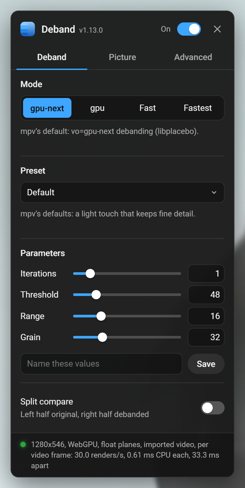
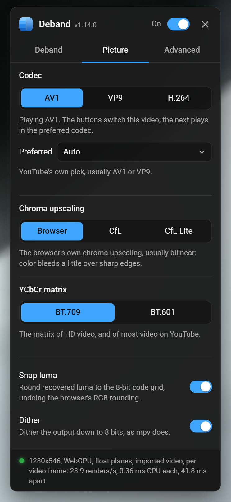

# YouTube Deband

A userscript that removes color banding from YouTube video in the browser, using
WebGPU and WebGL ports of [mpv](https://mpv.io/)'s deband shaders with mpv's own
parameters.

Left half: the video as the browser shows it. Right half: debanded. YouTube's 720p
stream of Sintel at 0:35, default settings; more in [Comparison](#comparison).

**Features**

- mpv's **gpu-next** (libplacebo) and **gpu** debanding, plus **Fast** and
  **Fastest** modes for weak GPUs and integrated graphics
- mpv's four deband parameters, presets, and import from your own `mpv.conf`
- Optional **CfL** chroma upscaling, ported from the shaders mpv users load
- Switching the video between YouTube's **AV1**, **VP9** and **H.264** streams,
  and a preferred codec for every video
- Renders with WebGPU, WebGL2 or WebGL1, so it also runs in Tor and Mullvad Browser
- A settings panel in the player and a split-screen comparison view

**Contents:** [Install](#install) · [Usage](#usage) · [Comparison](#comparison) ·
[Modes](#modes) · [Chroma upscaling](#chroma-upscaling) · [Codecs](#codecs) ·
[Renderers](#renderers) · [Compatibility](#compatibility) · [How it works](#how-it-works) ·
[License](#license)

## Install

1. Install a userscript manager such as [Violentmonkey](https://violentmonkey.github.io/)
   or [Tampermonkey](https://www.tampermonkey.net/).
2. Open the [raw script](https://raw.githubusercontent.com/Pagal3/youtube-deband/main/youtube-deband.user.js)
   and confirm the install. Your userscript manager will pick up updates from
   the same URL.

## Usage

| Shortcut                          | Action                   |
|-----------------------------------|--------------------------|
| **Ctrl+Alt+D**                    | Toggle debanding         |
| **Ctrl+Alt+B** or the **DB** button in the player's control bar | Open the settings panel |

Both shortcuts can be re-recorded on the panel's **Advanced** tab.

### Settings panel

  
  

The panel has three tabs:

- **Deband**: the mode, presets, the four parameters and the split-screen
  comparison
- **Picture**: the video codec, chroma upscaling, the YCbCr matrix (709/601),
  luma snapping and output dithering
- **Advanced**: the renderer, upload precision, shortcuts, importing mpv
  options and resetting

The switch in its title bar turns debanding on and off, and Esc closes it.
Drag the panel by its title bar to move it (it remembers where);
double-click the title bar to put it back. Settings that Fast and Fastest
don't use are dimmed while one of them is picked.

| Setting          | Default    | mpv option                           |
|------------------|------------|--------------------------------------|
| Mode             | `gpu-next` | `--vo`                               |
| Iterations       | 1          | `--deband-iterations`                |
| Threshold        | 48         | `--deband-threshold`                 |
| Range            | 16         | `--deband-range`                     |
| Grain            | 32         | `--deband-grain`                     |
| Chroma upscaling | Browser    | `--glsl-shaders=CfL_Prediction.glsl` |

The parameter sliders only cover the useful part of mpv's ranges (iterations
up to 8, threshold up to 256, grain up to 128), while the number fields next to
them take everything mpv does. Values past the point of diminishing returns
that mpv's manual describes turn amber with a note on why: more than 4
iterations, a threshold over 128, grain over 64, or a range over 24 with
several iterations.

### Presets

Pick a preset under **Preset** to set the four deband values at once. The mode
and the other settings stay as they are.

| Preset      | Iterations | Threshold | Range | Grain | For                                              |
|-------------|------------|-----------|-------|-------|--------------------------------------------------|
| Default     | 1          | 48        | 16    | 32    | mpv's defaults                                   |
| Subtle      | 1          | 32        | 16    | 16    | High bitrate 1080p and up                        |
| Animation   | 4          | 35        | 16    | 4     | Anime and cartoons, where grain shows on flat colors |
| Strong      | 4          | 64        | 20    | 32    | Broad bands in skies, fog and gradients          |
| Aggressive  | 4          | 100       | 8     | 32    | Hard, close-set steps like blocky dark scenes    |
| Low bitrate | 4          | 128       | 16    | 48    | 480p and below, heavily compressed uploads       |

To make your own, set the values (or [import them from mpv](#importing-from-mpv)),
type a name under them and click **Save**. Saving under a name you already used
updates that preset, and the bin button next to the list removes the selected
one. When the values match no preset, the list shows **Custom**. **Reset all
settings** doesn't remove your presets.

### Importing from mpv

**Import from mpv** on the Advanced tab takes a whole `mpv.conf`, a few lines
of one, or command line flags, and reads them the way mpv does at startup:

- Comments are skipped, and profiles only count where a top-level
  `profile=<name>` applies them. Auto profiles (`profile-cond`) are skipped,
  since their conditions can't be checked in a browser.
- It picks up `deband=yes`, the four `deband-*` values, `vo` (`gpu` or
  `gpu-next` as the mode; Fast and Fastest count as gpu-next and stay picked)
  and `glsl-shaders` (a CfL shader as the chroma upscaling).
- Anything the text doesn't set keeps its value, and the status line lists
  what was applied.

`deband=no` is ignored, so an import never turns debanding off. Configs often
set it at the top level and turn debanding back on in an auto profile, for
example one for network streams, which is what YouTube is.

## Comparison

Banding is easiest to see with the contrast boosted (both halves get the same
curve). Left half original, right half debanded:

Sintel © Blender Foundation, [CC BY 3.0](https://creativecommons.org/licenses/by/3.0/), [durian.blender.org](https://durian.blender.org)

Near-black backgrounds band too. A talking-head video at 720p, 0:10:

With the darkest 8% stretched to full range, the original's background turns
out to be a few flat blocks of brightness:

Frame from [the largest hack. ever.](https://www.youtube.com/watch?v=_HaySrzDyWU) by voidzilla

## Modes

| Mode         | Based on                                    | For                                   |
|--------------|---------------------------------------------|---------------------------------------|
| **gpu-next** | libplacebo's `pl_shader_deband()`, mpv's default | Most systems (the default)       |
| **gpu**      | mpv's legacy `pass_sample_deband()`         | Matching mpv's `vo=gpu`               |
| **Fast**     | gpu-next cut down to a single pass          | Weak GPUs                             |
| **Fastest**  | Fast worked out at half resolution          | Laptop integrated graphics            |

- **gpu-next** ports [libplacebo](https://code.videolan.org/videolan/libplacebo)'s
  `pl_shader_deband()`
  ([`src/shaders/sampling.c`](https://code.videolan.org/videolan/libplacebo/-/blob/master/src/shaders/sampling.c)),
  with mpv's option mapping from
  [`video/out/vo_gpu_next.c`](https://github.com/mpv-player/mpv/blob/master/video/out/vo_gpu_next.c).
- **gpu** ports mpv's `pass_sample_deband()`
  ([`video/out/gpu/video_shaders.c`](https://github.com/mpv-player/mpv/blob/master/video/out/gpu/video_shaders.c)).

### Fast

If video stutters with debanding on, click **Fast** under **Mode** at the top
of the settings panel. It runs the gpu-next algorithm with the same
parameters, but in one pass straight from the video frame instead of four:

- no intermediate textures and no float textures or WebGL extensions
- always uploads the frame as 8-bit RGBA, the cheapest upload (WebGPU imports
  it instead)
- a cheap float hash instead of the pcg3d generator, which is slow on
  WebGL1, where it is emulated without integers
- shaders are only compiled for the mode in use

To keep it cheap, it debands chroma at full resolution with the same samples as
luma (gpu-next works on half-resolution chroma) and doesn't snap luma, so the
result is close to gpu-next but not identical.

On a GeForce RTX 3060 at 1080p, the debanding itself (without the frame upload
that every mode shares) takes about a third of the GPU time of gpu-next on
WebGL2, and a twentieth on WebGL1.

### Fastest

If Fast still stutters, as it can on laptop integrated graphics, click
**Fastest**. It runs Fast's debanding on a grid of half the resolution, one
point per 2×2 block of pixels, and adds the change it makes there to every
pixel; grain and dither stay per pixel. That cuts the scattered texture
fetches, most of Fast's cost, to a quarter.

Debanding changes a pixel by no more than the threshold and leaves edges
alone, so working it out at half resolution loses little: Fastest removes
about as much of the broad banding as gpu-next at the default settings, and
90% of what Fast removes at 4 iterations, but leaves the finest, pixel-wide
streaks, and its noise is softer.

On an AMD Ryzen 5000 series integrated GPU (Radeon Vega) at 1080p60, Fastest's
debanding takes about a quarter of Fast's GPU time at the default settings and
a third at 4 iterations. What remains is mostly the browser copying each video
frame for WebGL or WebGPU, which every mode pays: with default settings the
GPU was 13.5% busy in Fastest and 15.4% in Fast, of which 11.4% was the copy.
If video still stutters in Fastest, pick 720p in YouTube's quality menu, which
more than halves both, and check that the browser decodes video in hardware.

## Chroma upscaling

YouTube video stores color (chroma) at half the resolution of brightness
(luma), and browsers upscale it bilinearly, so color bleeds a pixel or two
over sharp edges, most visibly red and blue on dark backgrounds. Under
**Chroma upscaling** on the Picture tab, **CfL** and **CfL Lite** replace that
with ports of `CfL_Prediction.glsl` and `CfL_Prediction_Lite.glsl` from
[GLSL Chroma from Luma (CfL) Prediction](https://github.com/Artoriuz/glsl-chroma-from-luma-prediction)
by João Chrisóstomo, the shaders mpv users load with `--glsl-shaders`. They
predict each pixel's color from its full resolution luma with least squares
fits over the chroma pixels around it, and fall back to a plain interpolation
where luma and chroma don't correlate. CfL Lite takes fewer samples and skips
the final smoothing pass.

- They work with gpu-next and gpu, not Fast or Fastest. On a GeForce RTX 3060
  at 1080p, where gpu-next debanding takes about 0.16 ms of GPU time per
  frame, CfL adds about 0.5 ms and CfL Lite about 0.4 ms.
- They start from the chroma plane the script rebuilds from the browser's
  RGB, which has already been through the browser's bilinear upscaling, so
  edges come out sharper than the browser's but a little softer than mpv's
  on the original file.
- mpv runs CfL on the debanded planes. Here it runs on the planes before
  debanding and the deband change is added on top, which saves debanding luma
  into a render target first.
- An `mpv.conf` pasted into **Import from mpv** that loads either shader
  picks it.

## Codecs

YouTube offers most videos in three codecs, and its player picks one, usually
AV1 where the browser can decode it and VP9 elsewhere. **Codec** on the
Picture tab shows which one the video is playing and changes it:

- The **AV1**, **VP9** and **H.264** buttons switch the video you're watching.
  It carries on from where it was, at the same speed, and stays paused if it
  was. The switch lasts for that video; the next one plays in the preferred
  codec. Codecs the video doesn't come in, or the browser can't play, are
  dimmed, with the reason when you hover over them.
- **Preferred** picks the codec for every video. Videos that don't come in it
  play in what YouTube picks, and changing it applies to the video you're
  watching straight away.

| Codec | Decoded by the GPU on                                   | But                                                                    |
|-------|---------------------------------------------------------|------------------------------------------------------------------------|
| AV1   | GPUs from about 2020 on (NVIDIA RTX 30, Intel 11th gen) | Older GPUs leave it to the CPU, which can stutter at high resolutions  |
| VP9   | Most GPUs from 2016 on                                  | Takes more data than AV1 for the same picture                          |
| H.264 | Nearly every GPU                                        | YouTube usually offers it only up to 1080p, and it takes the most data |

Debanding works the same on all three. On integrated graphics without AV1
decoding, VP9 or H.264 leaves it more headroom.

Ads play in whatever YouTube picks for them. The script steers the player by
removing the other codecs' streams from the list it picks from, and doesn't
touch what the browser reports it can play, which the ads and YouTube's own
capability checks rely on.

## Renderers

**Renderer** on the Advanced tab picks the graphics API. **Auto** (the
default) uses WebGPU where the browser has it, otherwise WebGL2, otherwise
WebGL1.

- The WebGPU renderer runs the same passes with the shaders ported to WGSL.
  Given the same frame, gpu-next and CfL produce the same pixels as on WebGL2.
  gpu, Fast and Fastest differ by a code value or two in places, because their
  random numbers come from float hashes that round differently on each API.
- WebGPU imports the video frame as an external texture instead of uploading
  a copy. Where a browser can't import video it copies the frame like WebGL2
  does (in the format set under **Upload**), which costs more.
- If WebGPU fails while rendering, Auto switches to WebGL until the page is
  reloaded or a renderer is picked in the panel. If the GPU device is lost
  (a driver reset, say), it sets up again.

On an NVIDIA Ampere GPU at 720p, both renderers take a few hundredths of a
millisecond of CPU time per frame and a fraction of a millisecond end to end,
with WebGL2 slightly ahead. If WebGPU misbehaves on your system, pick WebGL2.

## Compatibility

### Browsers

| Browser                         | Status                                                          |
|---------------------------------|-----------------------------------------------------------------|
| Chrome, Edge, Brave, Opera      | Full support                                                    |
| Firefox                         | Full support; before 132 it renders per display frame instead of per video frame |
| Safari 15.4+                    | Should work, less tested                                        |
| Tor / Mullvad Browser           | WebGL1 fallback; fingerprinting protection limits video to 1080p |
| WebGL disabled (NoScript, safest security level) | Not supported; the video plays normally        |

Auto renders with WebGPU in Chrome and Edge 113+, Safari 26+ and Firefox 141+
on Windows, and with WebGL elsewhere. WebGPU has only been tested in
Chromium; in other browsers the script falls back to WebGL if it fails.

### Userscript managers

Violentmonkey (recommended), Tampermonkey, Greasemonkey, FireMonkey and
Userscripts for Safari. The script uses no `GM_*` APIs. Settings and your
presets are kept in youtube.com's `localStorage`, so clearing YouTube's site
data resets them.

### Pages

Watch pages, theater mode, fullscreen and embeds (including
youtube-nocookie.com). YouTube Music is excluded. Shorts and m.youtube.com
are untested, and on mobile there is no DB button. Codec switching is
untested in embeds.

### Videos it skips

It shows a notice, and the video plays undebanded:

- DRM protected video (purchased or rented movies, some Premium content).
  Browsers don't let WebGL or WebGPU read it.
- HDR (PQ/HLG, BT.2020). Browsers don't give scripts the full HDR signal:
  WebGL receives it cut to 8 bits, and WebGPU receives it already converted
  to SDR, so debanding it would look worse than the video it replaces.
  YouTube sends HDR only to HDR displays, so on an SDR display you get the SDR
  version, which is debanded as usual. Detecting HDR needs WebCodecs
  (`VideoFrame`).
- Resolutions above the browser's texture limit.

SD videos encoded as BT.601 need the matrix set to 601 on the Picture tab for
exact colors. 4K and higher work, but the cost grows with resolution.

## How it works

Like mpv, the script debands the Y and subsampled CbCr planes separately
before color conversion. It undoes the browser's YCbCr→RGB conversion,
rebuilds the planes, debands each one, converts back and draws on a canvas
laid over the `<video>`. Toggling it swaps that canvas in and out, placed so
the picture doesn't move.

## License

LGPL-2.1-or-later, matching libplacebo and mpv, whose shaders this ports.
See [LICENSE](LICENSE). The CfL shaders are ported from MIT licensed code,
whose notice is kept with the port in the script.
